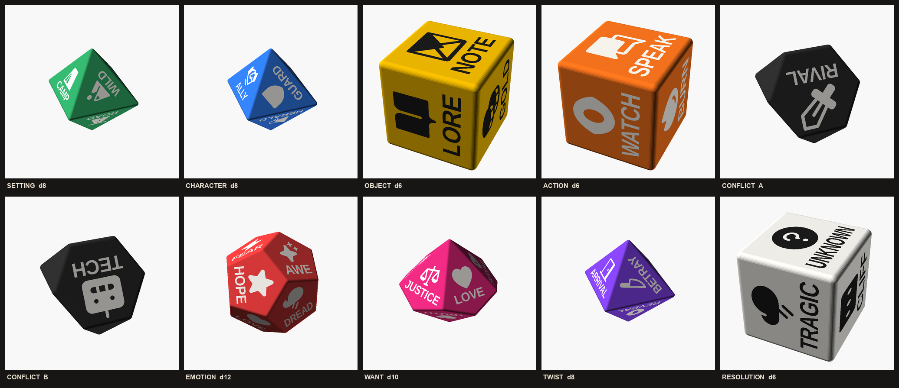

# Story Dice

Ten 3D-printable dice that roll a story prompt. Each category fills one blank
in a sentence. Roll them all and read it out.

> In **[Setting]**, a **[Character]** with an **[Object]** must **[Action]**,
> but faces **[Conflict]**, feeling **[Emotion]**, because they want **[Want]**,
> until **[Twist]**, and it ends **[Resolution]**.

**TL;DR**

- Download the STLs from the [latest release](https://github.com/weeeha/story-dice/releases/latest).
- The labelled set needs a 0.2 mm nozzle. The icon-only set prints on a standard 0.4 mm nozzle.
- Status: designed and rendered, not yet test-printed. Reports from real prints are welcome.

## The dice

Each category gets the shape that fits its vocabulary, so no deck is cut down
to six faces. Icons are 8 mm on every face except Conflict's larger 9.5 mm, so
the bigger decks make bigger dice. Size is the widest measurement of the
printed die.

| Category | Shape | Size | Faces | Suggested colour |
|---|---|---|---|---|
| Setting | d8 octahedron | 41 mm | CITY, TOWN, WILD, ROAD, HOME, CIVIC, CAMP, VOID | green |
| Character | d8 octahedron | 41 mm | HERO, MENTOR, GUARD, HERALD, SHIFTER, SHADOW, ALLY, TRICK | blue |
| Object | d6 cube | 18 mm | SECRET, LORE, CLUE, NOTE, BREW, GOLD | yellow |
| Action | d6 cube | 18 mm | FLEE, WATCH, TAKE, SPEAK, FLY, BURN | orange |
| Conflict | 2 × truncated tetrahedron | 25 mm | SELF, RIVAL, STATE, NATURE and FATE, TECH, SPIRIT, CHAOS | black |
| Emotion | d12 dodecahedron | 32 mm | JOY, GRIEF, LOVE, FEAR, HOPE, DREAM, RAGE, WARMTH, DREAD, NUMB, AWE, DOUBT | red |
| Want | d10 trapezohedron | 39 mm | SURVIVE, LOVE, POWER, FREEDOM, JUSTICE, REVENGE, BELONG, REDEEM, RENOWN, TRUTH | magenta |
| Twist | d8 octahedron | 41 mm | REVERSE, UNMASK, BETRAY, REVEAL, DEATH, DOUBLE, ARRIVAL, UNRAVEL | purple |
| Resolution | d6 cube | 18 mm | HAPPY, TRAGIC, BITTER, UNKNOWN, CIRCLE, CLIFF | white |

Conflict's eight faces are split across two dice of four.

## Printing

Each release has two zips, one per set. Every die comes as a body
(`<die>.stl`) and an inlay part (`<die>_ink.stl`).

- **labelled**: icon plus a word on every face. The letter strokes are about
  0.5 mm wide, so this set needs a 0.2 mm nozzle.
- **icons**: no words, icons 1.45 times larger and centred. Prints on a 0.4 mm nozzle.

The artwork is recessed 0.6 mm into each face. To colour it, fill the recesses
with acrylic paint and wipe the face clean. White ink reads well on the dark
bodies and black on yellow and white. With a multi-material printer, load
`<die>.stl` and `<die>_ink.stl` together as one object with two parts and give
the ink part its own filament.

The face that sits on the bed prints its recess as a bridge, so it comes out
rougher than the others.

## Change the dice

Everything is plain [OpenSCAD](https://openscad.org) (2021.01 or newer).

- **Render one die**: open `scad/kit.scad`, pick a die in the Customizer,
  render (F6) and export STL.
- **Change a face**: edit its `[icon, label]` pair in `scad/kit.scad`. Icons are
  [Phosphor](https://phosphoricons.com) Fill names; put the SVG in `icons/`.
- **Build everything**: `tools/build.sh --ink` writes every body and inlay
  STL to `out/`. Add `--png` for previews. If `openscad` isn't on your PATH,
  set `OPENSCAD=/path/to/openscad`. A full build takes a while; `--only want`
  builds one die.
- **Change or add a shape**: edit `tools/face_tables.py` and run it. It
  regenerates `scad/shapes.scad` and needs Python with numpy.

Labels use Liberation Sans Bold, which ships with OpenSCAD. Label fitting
assumes that font, so a wider font can overrun its faces.

## How it's made

Each die body is the convex hull of small spheres placed at the corners of a
polyhedron, which rounds every edge by 1 mm. For each face,
`tools/face_tables.py` stores the outward normal, the direction the artwork's
top should point and the face's distance from the centre. The OpenSCAD library
in `scad/story_die.scad` uses that frame to cut an icon and a label into every
face. Each solid is scaled so its faces have the same 8 mm inscribed radius,
which keeps the icons one size across the kit.

The generator also works out how much room each face leaves for a label. Cube
artwork runs square to the edges, and on the d10 the stack slides towards the
wide end of each kite. A word that is still too wide is condensed
horizontally, using measured widths of Liberation Sans Bold, so no letter
runs off its face.

## Known issues

- Nothing has been printed yet. Label legibility at 0.2 mm is unverified.
- Long words are condensed, which thins their strokes. The tightest are
  WARMTH on Emotion, at about half width, and UNKNOWN on Resolution, at about
  60%. A larger Emotion die or shorter words would fix it.
- A Conflict die always lands on a hexagon, so its result faces the table.
  Turn it over to read it. Moving the result to the small triangle on top is
  an open idea, and so is how the two Conflict dice combine in play.

## Licence

- Dice designs, STLs and renders: [CC BY 4.0](LICENSE-MODELS.md).
- Code in `scad/` and `tools/`: [MIT](LICENSE).
- Icons: [Phosphor Icons](https://phosphoricons.com), [MIT](icons/LICENSE).
